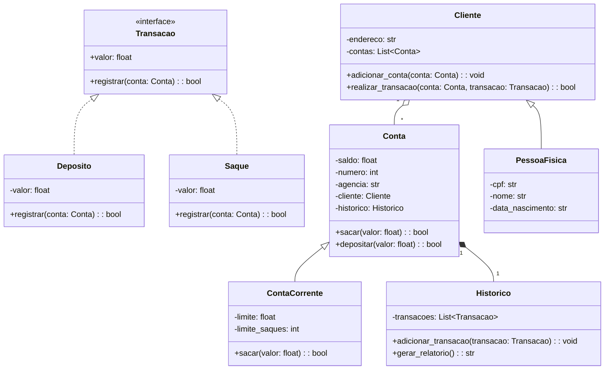

# 🏦 Sistema Bancário em Python — Regras, Domínio e Evolução de Arquitetura

[](https://www.python.org/)
[]()
[]()
[](LICENSE)

> Simulação de operações bancárias desenvolvida em duas abordagens — procedural e orientada a objetos — para demonstrar como requisitos financeiros podem ser traduzidos em **regras de domínio, estados, validações e testes verificáveis**.

## Problema

Operações bancárias aparentemente simples envolvem várias regras: saldo disponível, limites por transação, quantidade máxima de saques, histórico, relacionamento entre cliente e conta e consistência das movimentações.

O desafio deste projeto é modelar essas regras de forma clara, testável e evolutiva.

## Contexto de negócio

O projeto usa um domínio próximo da minha trajetória profissional: serviços financeiros, clientes, regras operacionais e controle de risco básico. Isso permite praticar desenvolvimento a partir de um problema conhecido no mundo real, em vez de apenas exercitar sintaxe.

## Solução

Foram implementadas duas versões do mesmo domínio:

### 1. Versão procedural — `sistema_bancario.py`

Focada em lógica algorítmica, validação de entrada, condicionais e fluxo de execução.

### 2. Versão orientada a objetos — `sistema_bancario_poo.py`

Modela o domínio com separação de responsabilidades entre clientes, contas, histórico e transações.

Principais elementos:

- `Transacao` como abstração para operações financeiras;
- `Deposito` e `Saque` como implementações concretas;
- `Conta` e `ContaCorrente` para estado e regras financeiras;
- `Cliente` e `PessoaFisica` para relacionamento com contas;
- `Historico` para rastreabilidade das movimentações.

## Arquitetura de domínio



## Regras de negócio

### Depósito
- aceita apenas valores maiores que zero;
- atualiza o saldo;
- registra a operação no histórico.

### Saque
- impede valor superior ao saldo disponível;
- respeita limite máximo por operação;
- respeita quantidade máxima de saques;
- registra a movimentação quando concluída com sucesso.

### Histórico
- mantém rastreabilidade das operações realizadas;
- permite comparar estado final da conta com movimentações registradas.

## Testes automatizados

A suíte de testes cobre regras críticas do domínio:

```bash
python -m unittest test_sistema_bancario.py
```

Cenários cobertos:

- depósito válido;
- rejeição de depósito zero ou negativo;
- saque válido;
- bloqueio por saldo insuficiente;
- bloqueio por limite da operação;
- bloqueio após o limite de saques.

## O que este projeto demonstra

- tradução de requisitos financeiros em regras de software;
- evolução de uma solução procedural para modelagem orientada a objetos;
- encapsulamento e separação de responsabilidades;
- uso de abstração e herança em um domínio compreensível;
- testes de regras críticas;
- raciocínio sobre estado, validação e consistência.

## Decisões e trade-offs

A aplicação permanece em memória e via terminal para manter o foco no domínio. O objetivo desta versão não é simular uma plataforma bancária de produção, mas tornar explícitas as regras e a evolução da modelagem.

Isso também deixa claros os próximos passos técnicos, sem adicionar complexidade apenas para ampliar a lista de tecnologias.

## Próximas evoluções

- persistência com PostgreSQL;
- API REST;
- autenticação e autorização;
- identificação idempotente de operações;
- limites configuráveis por conta;
- testes de integração;
- logs e auditoria estruturada;
- tratamento de concorrência em movimentações.

## Perguntas que este projeto permite discutir em entrevista

- Como você separaria regra de negócio de interface de usuário?
- Como garantiria consistência de saldo com operações concorrentes?
- Como evoluiria o histórico para uma trilha de auditoria real?
- Onde colocaria idempotência em uma API de movimentação financeira?
- Que mudanças seriam necessárias para levar este domínio a uma aplicação web?

## Como executar

### Pré-requisitos

Python 3.10 ou superior.

### Versão orientada a objetos

```bash
python sistema_bancario_poo.py
```

### Versão procedural

```bash
python sistema_bancario.py
```

## Valor profissional

Este projeto conecta diretamente **tecnologia + regras financeiras + modelagem de processos**. Ele demonstra minha evolução técnica sem separar essa evolução do conhecimento de domínio acumulado em ambientes financeiros.

## Autor

**Daniel Fernando Martins**  
[LinkedIn](https://www.linkedin.com/in/danielfernandomartins) · [GitHub](https://github.com/danielfernandomartins) · [E-mail](mailto:dfernandom@outlook.com)

## Licença

Distribuído sob a licença **MIT**. Consulte [LICENSE](LICENSE).
